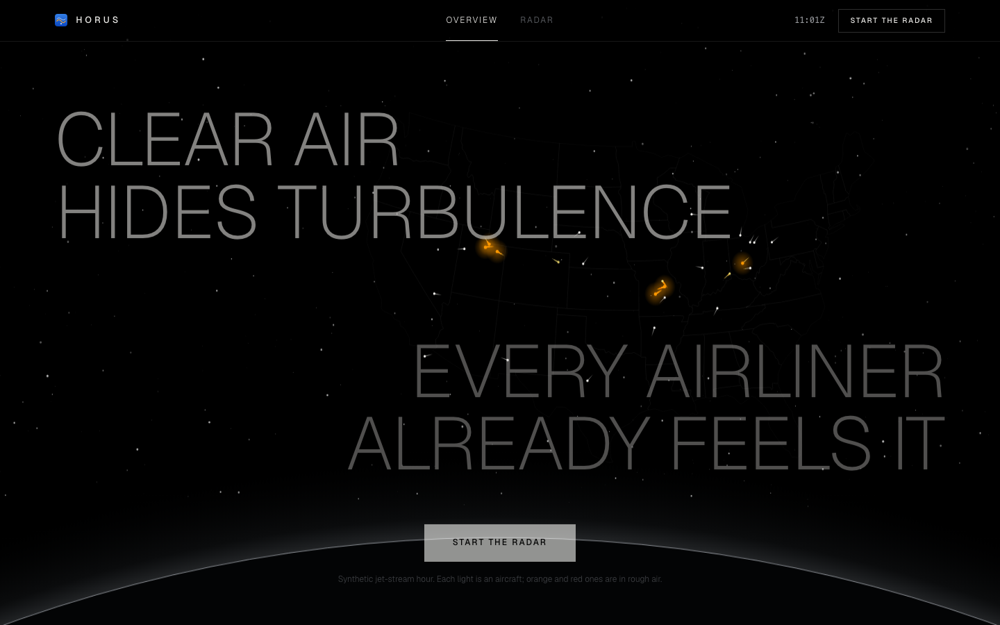
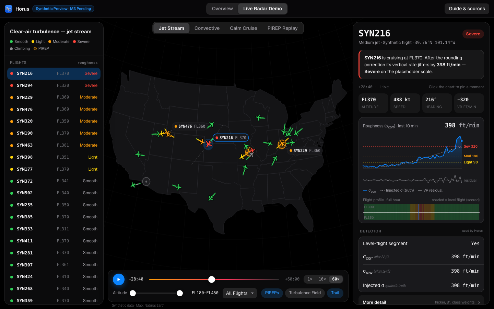

# Horus

Live turbulence detection and nowcasting from public aircraft broadcasts (ADS-B), validated against pilot reports (PIREPs) over the continental US.

> **Research prototype. Validated over continental US only. Not for operational use.**

Status: under construction (see `SPEC.md` and `PROGRESS.md`). Headline results will be filled in from `reports/` once benchmarks exist.

## Offline demo




```bash
make demo        # http://127.0.0.1:8765/  (no internet needed)
```

Designed from a study of related sites (docs/design-brief.md): aviationweather.gov conventions for the radar
(bottom timeline, layer strip, flight levels, caret PIREP symbols, AWC moderate/severe colours), the calm
label-plus-statement structure of well-made product pages, and a night-sky opening scene. The overview walks
through the problem, five pipeline steps with hands-on labs, computed proof numbers, four synthetic skies, a dated
comparison with published turbulence products, and the roadmap. **All aircraft, turbulence and PIREPs are
synthetic**; every number shown is computed from the bundled data or read from `config.yaml`. Horus reports
roughness in ft/min (σ_corr), not EDR. The page loads nothing from the internet (the server sends a
same-origin-only Content-Security-Policy). `make gate-demo` checks the endpoints, the
offline guarantee and the release bundle.

## Release bundle

`make bundle` writes `dist/horus-push-bundle.tar.gz` and `dist/PUSH_MANIFEST.txt`
(SHA-256 and size of every file). It contains exactly what git would push (tracked +
non-ignored files), refuses secrets and bulk data, and is reproducible byte for byte.

## Data sources and attribution

**OpenSky Network.** Live and historical (Trino) state vectors are used under the OpenSky Network terms of use for academic, non-commercial research: <https://opensky-network.org/about/terms-of-use>. As the terms require, please cite:

> Matthias Schäfer, Martin Strohmeier, Vincent Lenders, Ivan Martinovic and Matthias Wilhelm. "Bringing Up OpenSky: A Large-scale ADS-B Sensor Network for Research". In *Proceedings of the 13th IEEE/ACM International Symposium on Information Processing in Sensor Networks (IPSN)*, pages 83–94, April 2014.

**adsb.lol** historical traces (`adsblol/globe_history_*`), © adsb.lol contributors, licensed under the [Open Database License (ODbL) 1.0](https://opendatacommons.org/licenses/odbl/1-0/).

**PIREPs:** Iowa Environmental Mesonet PIREP archive (Iowa State University) and the NOAA Aviation Weather Center Data API (aviationweather.gov).

**Aircraft types:** OpenSky aircraft database and ICAO Doc 8643 type designators.

**Winds:** NOAA GFS (via Open-Meteo).

**Map outline:** Natural Earth 1:110m admin-1 states (public domain).

## License

MIT License · © 2026 Rohit Raj (see `LICENSE`).
