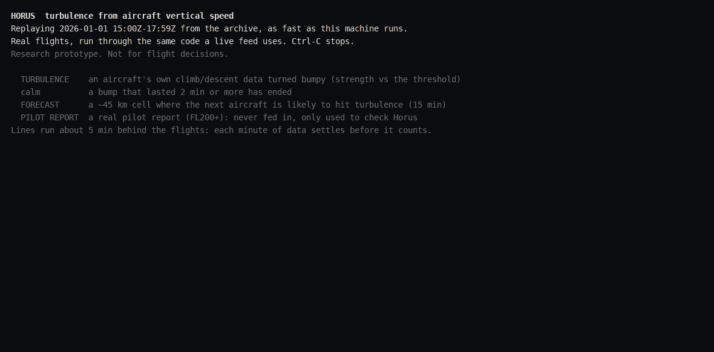
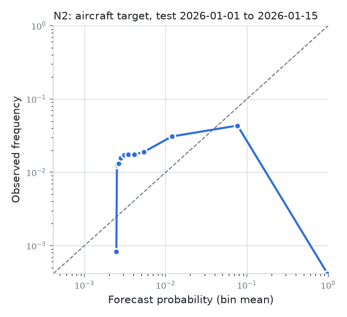

# Horus

Turbulence detection and 15-minute forecasting from public aircraft broadcasts (ADS-B vertical rate), checked against pilot reports over the continental US.

> **Research prototype. Not for flight decisions or any operational use.**



## What it does

Every airliner broadcasts its vertical rate about once a second. In turbulence, that number jitters. Horus turns the aircraft already in the sky into a turbulence sensor network:

1. **Detect.** For each aircraft in level flight, remove the slow climb/descent trend and measure what is left, after correcting for ADS-B's 64 ft/min rounding. Divide by what that aircraft type normally shows in smooth air, so a small jet and a 777 are on the same scale.
2. **Forecast.** Each detection raises the odds of turbulence in its 3D cell (H3 cells about 45 km across and 2,000 ft deep). The odds fade back to normal with a half-life fitted from data, and drift with GFS upper winds.
3. **Check.** Pilot reports (PIREPs) are never fed in; they are only used to score the detector and the forecast.

## Quick start

```bash
make up       # Python env + the data for the demo day (first run streams ~3.5 GB, 10-30 min)
make watch    # live text stream: an archived afternoon replayed through the live loop at 30x
make cases    # three case studies, told minute by minute
```

Needs [uv](https://docs.astral.sh/uv/), macOS or Linux, and about 2 GB of free memory. Everything runs locally from public data; no account or API key. `make serve` exposes the same live loop as a JSON + WebSocket API on `127.0.0.1:8000`.

## What you see

`make watch` prints one line per event. This excerpt is from `docs/watch-sample.txt` (2026-01-01, a test day the models never saw):

<!-- BEGIN:sample -->
```text
 15:04Z  PILOT REPORT  moderate at FL370 over NY (B737).  Horus: 1 aircraft passed within 40 km just before, none felt it; forecast normal
 15:05Z  ·             2,033 aircraft above FL200 · 0 in turbulence · 0 forecast cells above 5× normal
 15:09Z  TURBULENCE    a12f07  B39M  FL370   1.1× threshold  offshore
 15:09Z  FORECAST      FL360-380  offshore: 3.0% chance in the next 15 min (43× normal)
 15:10Z  ·             2,069 aircraft above FL200 · 1 in turbulence · 1 forecast cell above 5× normal
 15:15Z  ·             2,101 aircraft above FL200 · 0 in turbulence · 1 forecast cell above 5× normal
 15:20Z  ·             2,163 aircraft above FL200 · 0 in turbulence · 1 forecast cell above 5× normal
 15:23Z  PILOT REPORT  moderate at FL310 offshore (B77W).  Horus: no aircraft passed within 40 km just before; forecast normal
 15:25Z  TURBULENCE    a1d99b  A21N  FL340   1.3× threshold  over NM
 15:25Z  FORECAST      FL340-360  over NM: 3.0% chance in the next 15 min (43× normal)
 15:25Z  ·             2,195 aircraft above FL200 · 1 in turbulence · 1 forecast cell above 5× normal
 15:26Z  TURBULENCE    a95975  ?     FL470   3.2× threshold  over WI
 15:27Z  PILOT REPORT  moderate at FL430 over NM (GLF6).  Horus: 1 aircraft passed within 40 km just before, none felt it; forecast normal
 15:30Z  TURBULENCE    a416be  B738  FL360   2.3× threshold  over OH
 15:30Z  FORECAST      FL360-380  over OH: 3.0% chance in the next 15 min (43× normal)
 15:30Z  ·             2,232 aircraft above FL200 · 1 in turbulence · 2 forecast cells above 5× normal
 15:34Z  TURBULENCE    a788d3  A21N  FL320   1.2× threshold  over NM
 15:34Z  FORECAST      FL320-340  over NM: 3.0% chance in the next 15 min (43× normal)
  ...

Summary 15:00Z-15:56Z
  9 turbulence detections (runs of bumpy minutes)
  14 pilot reports of moderate or worse at FL200+: 11 had aircraft passing within 40 km and 2,000 ft in the 10 min before, and 0 of those had a detection
```
<!-- END:sample -->

| Line | Meaning |
|---|---|
| `TURBULENCE` | An aircraft's own vertical-rate data turned bumpy. Strength is shown relative to the alarm threshold. |
| `calm` | A bump that lasted 2 minutes or more has ended. |
| `FORECAST` | A cell where the next aircraft is now much more likely than normal to hit turbulence in the next 15 minutes. |
| `PILOT REPORT` | A real report of moderate or worse turbulence at FL200+, with what Horus saw there in the 10 minutes before. |

The stream runs about 5 minutes behind the flights. Each minute of data settles before it counts, so every line is a minute that the forecast grid and the evaluation actually used. `docs/cases-sample.txt` shows the three case studies.

## Results

<!-- BEGIN:results -->
Trained on 2025-12-02 → 2025-12-30 (train days only), tested on 2026-01-01 → 2026-01-15 (15 days). Generated from `reports/` by `scripts/readme_numbers.py`; CI fails if they differ.

- **Detector:** the best row (B3) scores PR-AUC **0.566** against a random-score baseline of 0.290, over 1788 MOD+ pilot-report windows and 4388 windows with no report.
- **But at strict alarm rates it catches little:** 0.2% of reported turbulence at 1 false alarm per 1,000 flight-hours, 5.7% at 10.
- **Nowcast:** wind advection (N2) ranks next-15-min detections at ROC-AUC **0.676** (climatology 0.500); PR-AUC 0.005 is 5.6× the base rate 0.0009. Negative evidence (N3) hurts (ROC-AUC 0.471).
- **Persistence:** a detection stays informative for t½ ≈ 11.6 min (FL200–290), 50.3 min (FL290–370), 49.9 min (FL370–460).
- **Speed:** one grid update for 10,000 aircraft takes 32.3 ms (p95); live latency p95 2.9 s for ~2,462 aircraft per snapshot.

**Detector** (MOD+ windows ±10 min / 40 km / ±2,000 ft; thresholds fitted on train days)

| Row | Method | PR-AUC 1 s | PR-AUC 10 s | ROC-AUC 1 s | Recall @ 1 FA/1000 h (1 s) | Recall @ 1 FA/1000 h (10 s) | Recall @ 10 FA/1000 h (1 s) |
|---|---|---|---|---|---|---|---|
| B0 | RMS vertical acceleration | 0.479 | 0.461 | 0.710 | 0.001 | 0.000 | 0.011 |
| B1 | B0 minus ADS-B rounding noise | 0.479 | 0.461 | 0.710 | 0.001 | 0.000 | 0.011 |
| B2 | B1 + level segments + residual σ (Sheppard) | 0.509 | 0.482 | 0.686 | 0.001 | 0.001 | 0.024 |
| B3 | B2 ÷ per-type smooth-air scale | 0.566 | 0.550 | 0.701 | 0.002 | 0.003 | 0.057 |

**Nowcast** (every 5 min, 15-min horizon; target: an aircraft entering the cell detects; grid 8,388 H3 res-4 cells × 13 FL bins)

| Row | Model | Brier | ECE | PR-AUC | ROC-AUC | ROC-AUC vs MOD+ PIREPs |
|---|---|---|---|---|---|---|
| CLIM | climatology (base rate) | 0.00087 | 0.00017 | 0.001 | 0.500 | 0.500 |
| N0 | persistence (no decay) | 0.00087 | 0.00015 | 0.001 | 0.511 | 0.502 |
| N1 | log-odds + fitted decay | 0.00087 | 0.00016 | 0.003 | 0.528 | 0.515 |
| N2 | N1 + GFS wind advection | 0.00087 | 0.00016 | 0.005 | 0.676 | 0.548 |
| N3 | N2 + negative evidence | 0.00088 | 0.00054 | 0.003 | 0.471 | 0.535 |

**Fitted decay half-life** (how long a detection keeps predicting the next aircraft's)

| FL band | t½ (min) | 95% interval (min) |
|---|---|---|
| FL200–290 | 11.6 | 3.3–12.5 |
| FL290–370 | 50.3 | 39.4–62.5 |
| FL370–460 | 49.9 | 36.9–61.2 |
<!-- END:results -->



Full tables, ablations and method notes are in [`reports/`](reports/): [detector](reports/detector_ablation.md), [window sensitivity](reports/window_sensitivity.md), [nowcast](reports/nowcast_ablation.md), [half-life](reports/half_life.md), [performance](reports/perf.md) and [data notes](reports/data_notes.md).

## Limitations

- **Low recall at useful alarm rates.** The detector ranks windows well above chance, but at an alarm rate a pilot would tolerate it catches only a few percent of reported turbulence. The text stream shows this plainly: most pilot reports come with "none felt it".
- **The labels are weak.** Pilot reports are sparse, delayed and roughly placed, and most turbulence is never reported. "No report" is not proof of smooth air, so the false-alarm rates are upper bounds.
- **Not true 1 Hz data.** The public adsb.lol archive stores a new vertical rate only when it changes by 200 ft/min or more (plus a ~20 s heartbeat). Horus rebuilds a held 1 s series from it; small jitters below the dead band are lost. Full-rate OpenSky history is approved but its queries are refused so far; the same benchmark reruns when they work.
- **Replay, not live.** Free live feeds give about one point per aircraft every 90 s, too sparse for the detector, so the live loop runs on an archived day. It is the code path a live feed would use, and a test checks it is bit-identical to the offline pipeline.
- **One winter, one region.** 44 days of data (2 December 2025 to 15 January 2026; 31 December was never published), continental US, FL200 to FL460.
- **Roughness, not EDR.** Horus measures roughness in ft/min, normalised per aircraft type. It is not calibrated to eddy dissipation rate (the aviation standard).

## How it is built

```
horus/ingest/   network + file I/O -> canonical Parquet (adsb.lol, OpenSky, PIREPs, GFS winds)
horus/core/     pure algorithms: segments, residual, normalisation, grid (no I/O, no clock)
horus/eval/     PIREP matching, negatives, benchmarks, plots
horus/api/      live loop + FastAPI/WebSocket
horus/watch.py  the text stream
reports/        every benchmark table and figure behind the numbers above
```

- The same `core/` functions run offline and live; a test replays a recorded half hour through both and requires identical results.
- Strict time split: thresholds, normalisation and decay are fitted on December, scored on January. `tests/test_leakage.py` fails if a test date appears in any fitted artefact.
- Every modelling choice has a benchmark row in `reports/`, and every parameter lives in `config.yaml`.
- Network code is tested against recorded real responses; tests never call live APIs.

```bash
make check                 # ruff, mypy (core + eval), pytest
make gate-m6               # milestone gates; see PROGRESS.md for the log
make bench                 # grid update performance
make readme                # regenerate the README numbers from reports/
```

CI (`.github/workflows/ci.yml`) runs lint, types, tests and the README number check. Rebuilding the M1–M5 benchmarks needs the full 45-day archive (`scripts/fetch_adsblol_history.py`, then `make scores`; hours of download and an overnight run), which `make up` does not fetch. `make bundle` writes a reproducible release archive of exactly the tracked files, refusing secrets and bulk data. The build log is in [`PROGRESS.md`](PROGRESS.md) and the design in [`SPEC.md`](SPEC.md).

## Data sources and attribution

**adsb.lol** historical traces (`adsblol/globe_history_*`), © adsb.lol contributors, licensed under the [Open Database License (ODbL) 1.0](https://opendatacommons.org/licenses/odbl/1-0/).

**OpenSky Network.** Live and historical (Trino) state vectors are used under the OpenSky Network terms of use for academic, non-commercial research: <https://opensky-network.org/about/terms-of-use>. As the terms require, please cite:

> Matthias Schäfer, Martin Strohmeier, Vincent Lenders, Ivan Martinovic and Matthias Wilhelm. "Bringing Up OpenSky: A Large-scale ADS-B Sensor Network for Research". In *Proceedings of the 13th IEEE/ACM International Symposium on Information Processing in Sensor Networks (IPSN)*, pages 83–94, April 2014.

**PIREPs:** Iowa Environmental Mesonet PIREP archive (Iowa State University) and the NOAA Aviation Weather Center Data API (aviationweather.gov).

**Aircraft types:** ICAO Doc 8643 type designators and the OpenSky aircraft database.

**Winds:** NOAA GFS via [Open-Meteo](https://open-meteo.com/) (CC BY 4.0).

**State outlines:** Natural Earth 1:110m admin-1 (public domain).

## License

MIT License · © 2026 Rohit Raj (see `LICENSE`).
